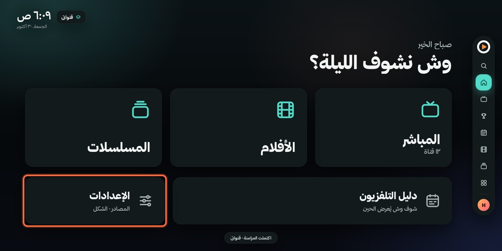
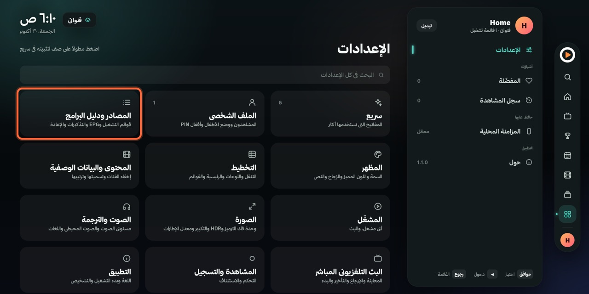
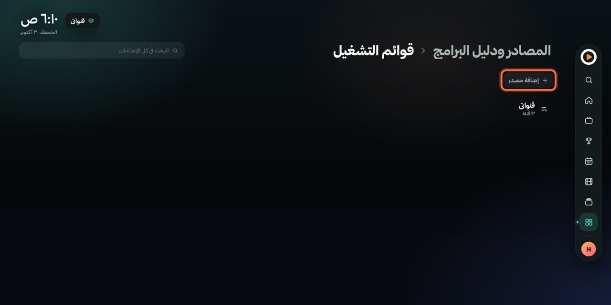
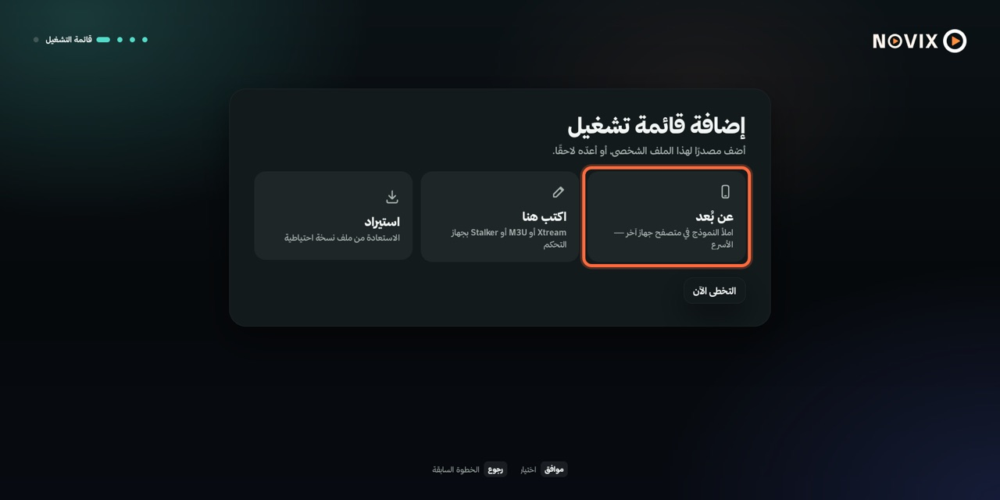
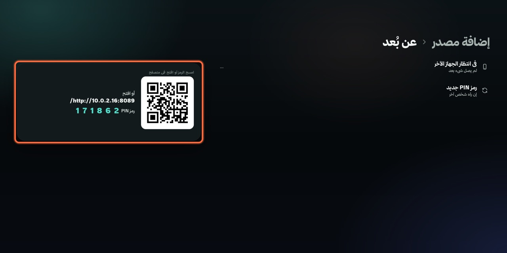
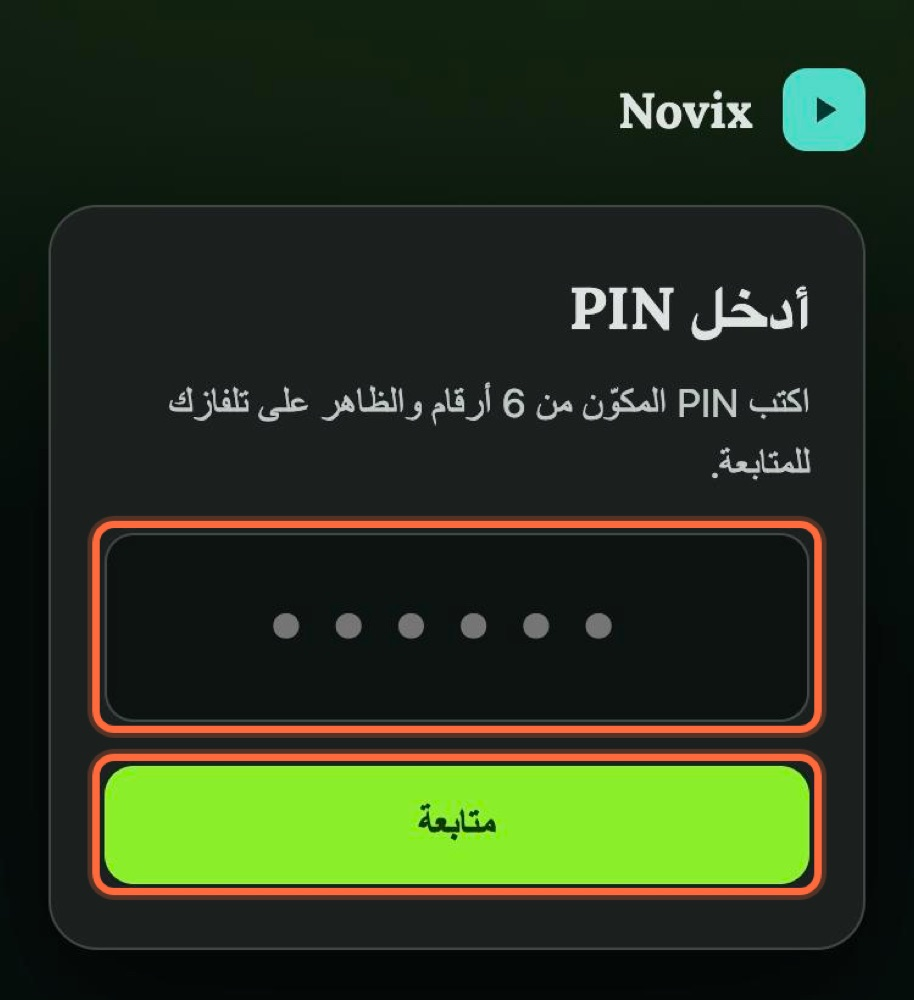
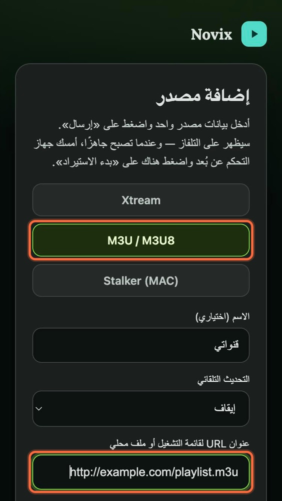
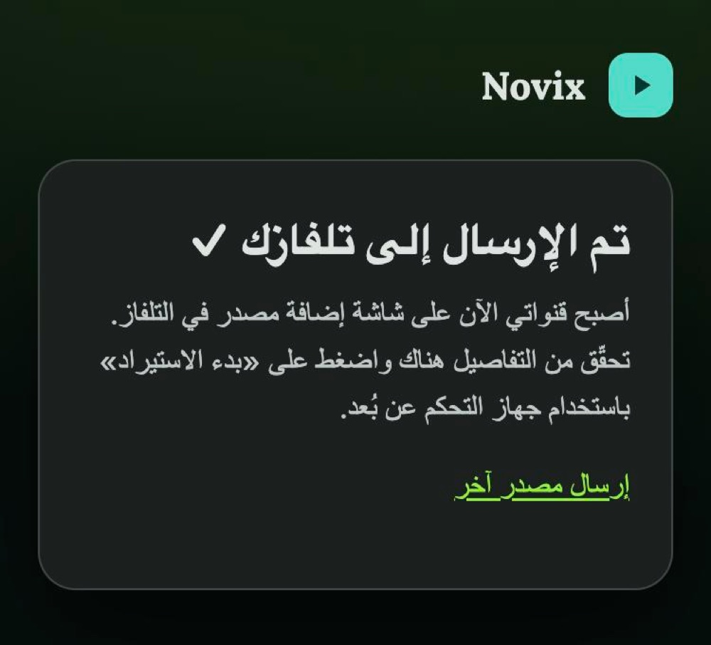
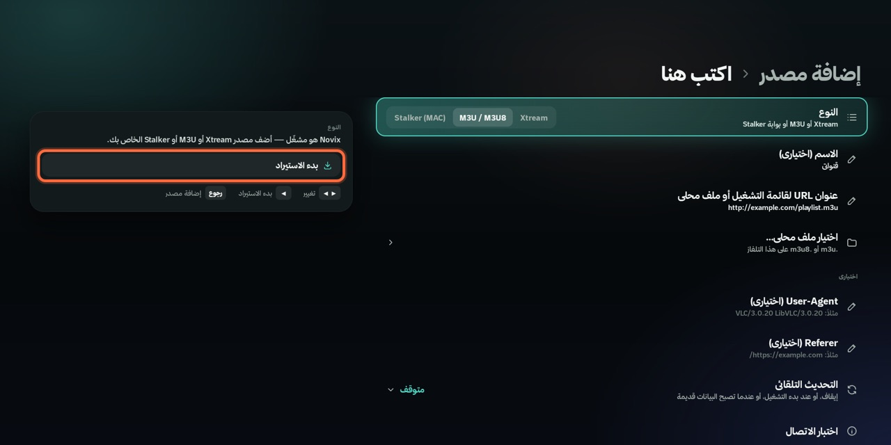
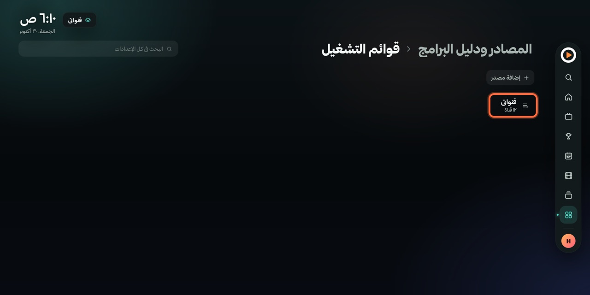

# Novix للتلفزيون

**Novix** مشغّل IPTV بالعربي لتلفزيونات Android TV و Google TV و Fire TV. تضيف مصدرك (رابط M3U أو بيانات Xtream)، وتلقى القنوات والأفلام والمسلسلات ودليل البرامج في شاشة بداية بسيطة.

> Novix مشغّل فقط، وما فيه أي قنوات. تحتاج اشتراك أو قائمة تشغيل خاصة فيك.

## 📺 طريقة التثبيت

### ١. ثبّت تطبيق Downloader
افتح **Google Play** في التلفزيون، وابحث عن **Downloader**، واضغط **تثبيت**.

### ٢. حمّل Novix
افتح **Downloader**، واكتب في خانة العنوان رمز Novix:

<b><code>&nbsp;6853610&nbsp;</code></b>

واضغط **Go**، ويبدأ التحميل. الرمز ثابت ويجيب لك دايم آخر نسخة.

| الطريقة | اكتب |
|:---|:---|
| رمز Downloader | `6853610` |
| رابط مختصر (أي متصفح) | `aftv.news/6853610` |
| الرابط الكامل | `github.com/ialaa-almehmadi/novix-releases/releases/latest/download/Novix-TV.apk` |

### ٣. ثبّته
- أول مرة يطلب التلفزيون السماح لـ **Downloader** بتثبيت التطبيقات: فعّله وارجع.
- اضغط **تثبيت**، وبعدها **فتح**.
- إذا طلعت رسالة **Google Play Protect**، اختر **مزيد من التفاصيل** ثم **التثبيت بدون فحص**.

## ➕ إضافة مصدر M3U

**المسار:** الرئيسية ← الإعدادات ← المصادر ودليل البرامج ← قوائم التشغيل ← إضافة مصدر

> أول مرة تفتح Novix، يوديك الإعداد على الخطوة ٤ مباشرة بعد ما تختار اللغة وتسوي ملفك.

**١.** من الرئيسية افتح **الإعدادات**.

**٢.** اختر **المصادر ودليل البرامج**، وبعدها **قوائم التشغيل**.

**٣.** اضغط **إضافة مصدر**.

**٤.** اختر **عن بُعد**، عشان تكتب الرابط من جوالك بدل ريموت التلفزيون.

**٥.** يطلع لك رمز QR ورقم PIN. امسح الرمز بكاميرا الجوال، أو اكتب العنوان اللي تحته في متصفح الجوال.
الجوال والتلفزيون لازم يكونون على نفس الواي فاي.

**٦.** في الجوال:
- اكتب رقم الـ PIN اللي على التلفزيون، واضغط **متابعة**.
- اختر **M3U / M3U8**، واكتب اسم للمصدر إذا تبي، والصق رابط M3U في خانة **عنوان URL**.
- انزل تحت واضغط **إرسال إلى التلفاز**.

| | | |
|:---:|:---:|:---:|
|  |  |  |
| رقم الـ PIN | النوع والرابط | تم الإرسال |

**٧.** ارجع للتلفزيون، وبتلقى البيانات معبّأة. اضغط **بدء الاستيراد**.

**٨.** بعد ما يخلص، يطلع المصدر في قوائم التشغيل مع عدد القنوات. ارجع للرئيسية بزر الرجوع، وابدأ من **المباشر**.

> ما عندك جوال؟ اختر **اكتب هنا** في الخطوة ٤، واكتب الرابط بريموت التلفزيون.
> الرابط في الصور تجريبي.

## 🔄 التحديث

من داخل Novix: **الإعدادات ← التطبيق ← التحقق من وجود تحديثات**. إذا فيه نسخة جديدة اضغط **التحديث الآن**، ووافق على رسالة التثبيت.

كل النسخ في صفحة [الإصدارات](https://github.com/ialaa-almehmadi/novix-releases/releases).

## 📄 الرخصة والكود

Novix مبني على [OwnTV](https://github.com/ahXN00/OwnTV) ومكتبته [OwnTV Core](https://github.com/ahXN00/OwnTV_Core)، وكلها برخصة **GPL-3.0**.
الكود الكامل لكل نسخة مرفق في صفحة إصدارها (ملف `source`)، وتقدر تبنيه وتعدّله وتنشره بنفس الرخصة.

خط ثمانية من [font.thmanyah.com](https://font.thmanyah.com)، ومضمّن داخل التطبيق بس.

## 💬 تواصل

تطوير **علاء المحمادي** · X و TikTok: **[@alaa_mehmadi](https://x.com/alaa_mehmadi)**

